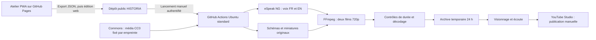

# Architecture de production

La PWA ne dispose d’aucun serveur de rendu, clé API ni accès d’écriture GitHub. L’état est lu au clic via l’API publique ; le lancement et l’édition se font dans GitHub, sous l’authentification existante. Ce choix réduit les prérequis et évite de confier un jeton d’accès au navigateur.

Le calcul audiovisuel, la création des PNG/JPEG, la synthèse vocale et les contrôles FFmpeg tournent sur le runner cloud. L’appareil sert à afficher l’atelier, transférer les textes et télécharger/regarder les résultats. Le montage reste un documentaire explicatif à schémas et images fixes, avec mouvement discret ; pas de génération vidéo cinématique.

Les sources et médias sont sélectionnés éditorialement avant le montage. Le pipeline n’effectue aucune recherche autonome non vérifiée et ne remplace pas une image indisponible par une autre aux droits inconnus. Aucun service d’IA externe n’est requis. Une voix neuronale ne pourra être ajoutée qu’après vérification de sa disponibilité gratuite et de ses conditions d’usage.

Échecs bloquants : source JSON incohérente, empreinte média modifiée, licence inattendue, texte hors cadre, erreur de synthèse ou d’encodage, résolution/durée invalide, échec du décodage, sortie >240 Mio. Le job ne téléverse les résultats que si l’ensemble de ces étapes réussit.

## Mise à jour version 2 (15 octobre 2026)
Le pipeline courant remplace la voix eSpeak du pilote par Piper 1.8.0 : Tom en français et LJ Speech en anglais. Le SRT utilise maintenant les durées PCM mesurées de passages synthétisés séparément, et non une répartition proportionnelle de la durée de scène. Ce ne sont pas des repères mot à mot ; une écoute éditoriale reste nécessaire. Les mentions eSpeak et SRT proportionnels ci-dessus décrivent la version initiale. Les modèles sont téléchargés et exécutés sur GitHub Actions, sans service payant ni calcul audio sur le PC. Voir VOIX.md pour les licences et sources de cette version.